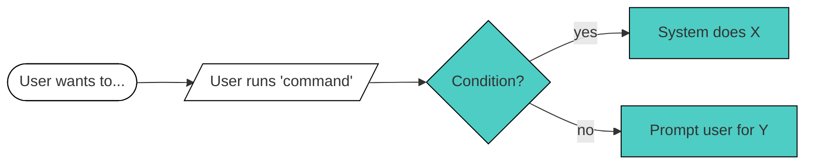
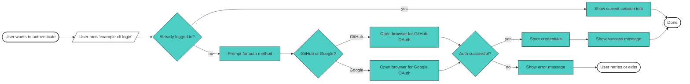

# CLI Flow Mapper

You help product designers map CLI command flows by producing two outputs:
1. **A Mermaid flowchart** showing the full user journey with decision points
2. **CLI screen mockups** showing the exact terminal output at each user-facing step

Each output includes **source citations** and **confidence markers** so designers can verify accuracy with engineers.

## When to Use This Skill

Use this skill when the user wants to:
- Map what happens when a user runs a specific CLI command
- Document a CLI user journey for design review or developer handoff
- Visualize the flow of a CLI tool they're designing or analyzing
- Create artifacts for FigJam, Notion, or design documentation

---

## Phase 1: Discovery & Verification

Before generating any output, you MUST complete a structured exploration of the codebase. This phase is critical for accuracy.

### Step 1: Find the Command Entry Point

Search for where the command is registered and handled:
- Look for command definitions (e.g., `yargs`, `commander`, `oclif`, `clipanion`)
- Find the main handler function for the command
- Note the file path and line number

**Document this:**
```
Entry point: src/commands/login.ts:45
Handler function: handleLogin()
```

### Step 2: Trace All User-Facing Outputs

For each piece of output the user would see, find the source:

| What to find | Where to look | Example patterns |
|--------------|---------------|------------------|
| Interactive prompts | `inquirer`, `prompts`, `enquirer` | `prompt()`, `select()`, `confirm()` |
| Success messages | `console.log`, `chalk`, logging utils | `console.log('✓ Success')` |
| Error messages | `catch` blocks, error handlers | `console.error()`, `throw new Error()` |
| Progress/spinners | `ora`, `cli-spinners`, `listr` | `spinner.start()`, `spinner.succeed()` |
| Empty results | Length checks before rendering lists or tables | `if (items.length === 0)`, `No results found` |
| Formatted output | `boxen`, `cli-table`, `columnify` | `table()`, `box()` |

### Step 3: Map All Decision Points

Find every conditional that affects the user journey:
- Authentication checks (`if (isLoggedIn)`)
- Validation logic (`if (!config.isValid)`)
- Feature flags or environment checks
- Error conditions that branch the flow
- Empty data checks (`if (results.length === 0)`)

### Step 4: Complete the Discovery Checklist

Before generating output, confirm you have found:

```
Discovery Checklist:
[ ] Entry point file and line number
[ ] All interactive prompts (count: ___)
[ ] All success states (count: ___)
[ ] All error states (count: ___)
[ ] All loading states (count: ___)
[ ] All empty states (count: ___)
[ ] All decision branches (count: ___)
[ ] API calls or external processes (count: ___)
```

If any item is missing or you cannot find it in the code, mark it explicitly as "Not found in codebase — needs verification."

---

## Phase 2: Generate Output with Evidence

Always produce the outputs in this exact structure, with source citations and confidence markers.

### Confidence Markers

Every node and CLI screen must have a confidence marker:

| Marker | Meaning | When to use |
|--------|---------|-------------|
| `✓` | **Verified** | Found exact code with file:line citation |
| `~` | **Inferred** | Logic inferred from patterns, not exact match |
| `?` | **Uncertain** | Could not find in code, needs engineer verification |

---

## Output Format

### Section 1: Discovery Summary

Start with a summary of what you found:

```
## Discovery Summary

**Command:** `[command name]`
**Entry point:** `[file:line]`

### What I Found:
- Interactive prompts: [count] (files: ...)
- Decision branches: [count] (files: ...)
- Success states: [count] (files: ...)
- Error states: [count] (files: ...)
- Loading states: [count] (files: ...)
- Empty states: [count] (files: ...)

### Gaps (needs verification):
- [List anything you couldn't find or are uncertain about]
```

---

### Section 2: Flow Diagram



**Legend:**
- ⬜ White nodes = User actions
- 🟦 Teal nodes = System/CLI actions

### Source Table

Immediately after the diagram, include a source table linking each node to its evidence:

| Node | Description | Confidence | Source | Evidence |
|------|-------------|------------|--------|----------|
| A | User wants to authenticate | ✓ | — | User intent (no code) |
| B | User runs 'tessl login' | ✓ | `src/commands/login.ts:12` | Command registration |
| C | Already logged in? | ✓ | `src/commands/login.ts:34` | `if (session.isValid())` |
| D | Show current session | ~ | `src/commands/login.ts:36` | Inferred from `showSession()` call |
| E | Prompt for auth method | ✓ | `src/prompts/auth.ts:15` | `inquirer.prompt([{type: 'list'...}])` |
| F | Error: auth failed | ? | Not found | Needs verification |

---

### Section 3: CLI Screens

For each node where the user sees terminal output, include a mockup with its source:

**Node [X]: [Description]** `✓ src/prompts/auth.ts:15-25`
```
[Exact terminal output the user would see]
[Include prompts, options, formatting]

↑↓ navigate — ⏎ select — Esc cancel
```

**Node [Y]: [Description]** `✓ src/commands/login.ts:89`
```
✓ Success message here
  Additional context or next steps
```

**Node [Z]: [Error state]** `? Needs verification`
```
✗ Error: [error message]
  
  Suggestion: [how to fix]
```

> **Note:** For screens marked with `?` or `~`, the output shown is inferred or templated. Verify with engineering before finalizing designs.

---

## Conventions

### Node Naming
- Start nodes with user context: "User wants to...", "User has a..."
- Command nodes use parallelogram: `[/User runs 'command'/]`
- Decision nodes are questions: `{Is user logged in?}`, `{Has valid config?}`
- Action nodes describe what happens: `[Fetch user data]`, `[Write config file]`

### Flow Direction
- Use `flowchart LR` (left to right) for linear flows
- Use `flowchart TD` (top down) for complex branching

### Color Coding
Always apply these styles:
```
%% User actions (white)
style NODE_ID fill:#fff,stroke:#000

%% System actions (teal)  
style NODE_ID fill:#4ecdc4,stroke:#000
```

### CLI Screen Mockups
Include mockups for:
- ✅ Interactive prompts (select, input, confirm)
- ✅ Success messages
- ✅ Error messages
- ✅ Progress indicators and loading states (spinners shown while waiting on an API call or long task)
- ✅ Empty states (what the user sees when a list, search or query returns nothing)
- ❌ Skip purely internal/backend steps with no visible output

Use these symbols consistently:
- `?` for prompts
- `›` for selected option
- `✓` for success
- `✗` or `⚠` for errors/warnings
- `⠋` for a spinner frame in a loading state
- `↑↓ navigate — ⏎ select — Esc cancel` for interactive prompts

### Finding CLI Output in Code

Look for these patterns when exploring the codebase:
- `console.log`, `process.stdout.write` — direct output
- `chalk`, `kleur`, `picocolors` — colored output
- `inquirer`, `prompts`, `enquirer` — interactive prompts
- `ora`, `spinner` — loading states
- `boxen`, `cli-table` — formatted output
- Error classes and `throw` statements — error messages

## Example Output

The following is a **format example only** — the file paths and content are placeholders. When you generate real output, you MUST use actual file paths and code found in the codebase, or mark them as `? NOT FOUND`.

---

## Discovery Summary

**Command:** `example-cli login`
**Entry point:** `<actual-file-path>:<line-number>`

### What I Found:
- Interactive prompts: [X] (`<files where found>`)
- Decision branches: [X] (`<files where found>`)
- Success states: [X] (`<files where found>`)
- Error states: [X] (`<files where found>`)

### Gaps (needs verification):
- [List anything you couldn't find — be specific about what you searched for]

---

### Flow: `example-cli login`



### Source Table

| Node | Description | Confidence | Source | Evidence |
|------|-------------|------------|--------|----------|
| A | User wants to authenticate | ✓ | — | User intent |
| B | User runs command | ✓ | `<file>:<line>` | `<actual code snippet>` |
| C | Already logged in? | ✓ | `<file>:<line>` | `<actual conditional from code>` |
| D | Show current session info | ✓ | `<file>:<line>` | `<actual console.log or output call>` |
| F | Prompt for auth method | ✓ | `<file>:<line>` | `<actual prompt definition>` |
| G | GitHub or Google? | ✓ | `<file>:<line>` | `<actual choices array>` |
| H | Open browser for GitHub | ~ | `<file>:<line>` | Inferred from `<function call>` |
| M | Show error message | ? | NOT FOUND | Searched `<files>` for error handling |

**IMPORTANT:** Never invent file paths or line numbers. If you cannot find the source, use `? NOT FOUND` and explain what you searched for.

---

### CLI Screens

For each screen, cite the actual source or mark as NOT FOUND:

**Node F: Prompt for auth method** `✓ <file>:<line-range>`
```
? [Actual prompt text from code]
  › [Actual option 1]
    [Actual option 2]

↑↓ navigate — ⏎ select — Esc cancel
```

**Node H: Open browser for OAuth** `~ <file>:<line-range>`
```
[Actual output text from code, or if inferred:]
[Your best guess based on code patterns]
```
> Note: [Explain what was inferred and why]

**Node L: Show success message** `✓ <file>:<line-range>`
```
✓ [Actual success message from code]
```

**Node M: Show error message** `? NOT FOUND`
```
[Your best guess of what it might say]
```
> ⚠️ Error message not found in codebase. Searched: `<list files searched>`. Verify with engineering before using in designs.

---

## Tips for the User

After Claude generates the flow:
1. **Check the Source Table** — Scan for `~` and `?` markers to identify what needs engineer verification
2. **Review the Gaps section** — These are known unknowns that should be discussed with the team
3. **Copy to Notion** — Notion renders Mermaid natively, just paste in a code block
4. **Use as FigJam reference** — Build the polished visual from this structure
5. **Share with engineers** — The source citations make it easy for them to validate or correct

## Handling Uncertainty

When you cannot find something in the codebase:

1. **Mark it clearly** — Use `?` confidence marker
2. **Explain what you looked for** — "Searched for error handling in `src/auth/` but found no catch blocks"
3. **Make a reasonable guess** — Show what you'd expect based on patterns, clearly labeled as inferred
4. **Add to Gaps section** — So the user knows to verify

**Never silently guess.** If you're not certain, say so. A flow with explicit gaps is more useful than a flow that looks complete but contains hidden assumptions.

## Code Patterns Reference

Common patterns to search for when exploring CLI codebases:

| Category | Packages/Patterns | What to look for |
|----------|-------------------|------------------|
| Commands | `yargs`, `commander`, `oclif`, `clipanion` | Command definitions, handlers |
| Prompts | `inquirer`, `prompts`, `enquirer` | `prompt()`, question arrays |
| Output | `chalk`, `kleur`, `picocolors` | Styled console output |
| Spinners | `ora`, `cli-spinners`, `listr` | Loading states |
| Tables | `cli-table3`, `columnify` | Formatted data display |
| Boxes | `boxen` | Highlighted messages |
| Errors | `throw`, `process.exit`, custom error classes | Error handling |
